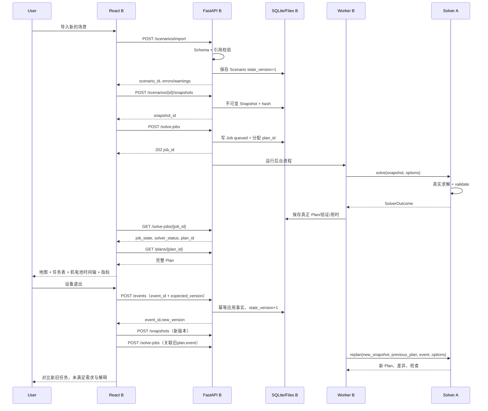

# 援航 Rescue-UAV｜全量开发与两人 Codex 协同总纲

> 本仓库适配说明：仅 A（算法/项目负责人）与 B（前端+后端+集成）两人。`C-*` 只保留为后端任务编号。原始 ZIP 留存于 `references/source/original-handoff.zip`。当前缺少旧版机器契约；新建 `0.1.0-draft` 仅为评审草案，状态见 `docs/DECISIONS.md`，不是已批准 V1 或已实现 API。

> **文件属性**：团队开发的统一需求与跨模块对接总纲（建议放在仓库 `docs/CODEX_MASTER_HANDOFF.md`）。
> **目标**：一次性交代最终完整系统的所有功能、算法、工程、展示、验证和参赛交付，不按天排期；分任务自主推进、按依赖和验收门槛集成。
> **现状**：此文件是**目标与执行规范**，不代表其中任一功能已完成。首次交给 Codex 时只做「现状检查、规范建立、接口裁决、任务拆分」，未经确认不得一口气生成全套业务代码。
> **产品**：“援航”——面向山区洪涝等灾害的无人机应急物资运输与通信协同调度决策支持系统。不是飞控，不提供未经实测的实飞安全保证。
> **依据**：团队的《无人机救援调度系统设计与开发方案》（2026-10-17版）、原数学建模题与论文、智慧城市大赛指南、此前 `rescue-uav-collab-kit` 的 V1 规则/Schema/Fixtures。所有新增工程决策与源文档既有结论应明确区分。

---

## 0. 最高优先级：如何阅读、如何执行

**本仓库当前实施说明优先**：旧 V1 的四份机器契约和五份样例未随 ZIP 提供。本次新建 `0.1.0-draft`，字段、状态和 P0 限制以 `docs/03-DATA-CONTRACT.md`、`04-API-CONTRACT.md`、`05-SOLVER-CONTRACT.md` 与 `CONTRACT_RFC_001.md` 为评审依据；本总纲中提及旧 V1 的格式与代码块是历史背景，不是可直接运行的当前协议。正式冻结前 `contracts/manifest.json` 保持 proposed。任务实时状态看 `docs/task-board.json`，本章任务表只保留范围和原始编号。

**全体人员及 Codex 的阅读顺序**：`AGENTS.md` → 本文件 → `docs/DECISIONS.md` → `contracts/*.schema.json` → `docs/03-DATA-CONTRACT.md`、`docs/04-API-CONTRACT.md`、`docs/05-SOLVER-CONTRACT.md` → 本人负责模块的 `AGENTS.md` 和源码。用户提供的系统设计方案是需求背景与范围依据；正式签字确认的机器契约/决策记录优先于示意代码。

**遇到冲突**：先记录 `Issue/RFC`，列出冲突字段、受影响者、旧/新示例、迁移方案；必须 A（算法）和 B（后端）确认计算契约，B（前端）确认 UI 契约后才能升级。不可出现两位成员的 Codex 分别发明一种 `Plan` 数据结构的情况。

**第一次执行只做规范基建，不做所有业务实现**：扫描真实 Git 仓库文件树→保存现有代码→登记完成度→识别旧规范可复用的部分→生成/修订规范文件与自动契约测试→提交一个只包含规范和脚手架的 PR→获得团队确认后进入开发；已有文件不可无提示覆盖。**后续阶段的全部任务已经在本文中，无须按日期再问用户。**

**真实状况优先**：未给原数模完整代码、五张 Excel、DEM 时，只能标 `blocked` 并使用明确 Mock 继续前后端开发；不凭论文的数字伪造当前程序已实现的能力。完整 Q2/Q3 原求解规模较大，实时接口必须提供真正独立可运行的快速求解与预算控制。

---

## 1. 项目目标、对象、范围

### 1.1 四个业务问题

1. **能运什么**：现有箱件、机体、电池、地形和通信条件下，哪些需求可以按硬截止完成，哪些资源存在缺口。
2. **怎样运**：按箱件生成架次、访问次序、机体/电池分配、时间、能耗、运输航线及必要的通信中继窗口。
3. **变化怎么办**：设备退出、箱件变更、落点不可用、地图区域变化后，只重排可修改的未来任务，保留已发生的事实并可解释调整原因。
4. **如何取舍**：同样的保障任务与硬约束下，对比时间、能耗、费用（需费率）、基本保障均衡与额外余量，选择方案并输出执行任务单和复盘材料。

### 1.2 角色与场景

- **应急指挥人员**：查看全局关键需求、未保障清单与策略对比；审核并选择方案。
- **无人机调度员**：核对架次、起降点、航路、实体机体/电池、中继窗口；接受事件并重新调度。
- **物资保障人员**：导入库存、装箱，查看每箱去哪、何时被预约/装载/交付，导出物资任务单。
- **模拟/演练模式**为默认落地目标；真实现场输入仅为规划辅助。前端必须可区分**真实上传的数据**、**真实算法计算的模拟方案**、**人工确认的实际交付事实**。

### 1.3 原数模起点与限制

原题/论文建立了：Q1 单点安全载荷与整箱组批，Q2 异构运输机+共享电池+时间窗调度，Q3 运输与双跳通信中继联合优化，Q4 冻结任务后的分区与资源配置。原题标准实例为 **1 基地、15 个服务区、80 个箱件、A/B 三型共 8 架运输机、14 组运输电池、2 架中继机及 6 组中继能源组件**；30 m DEM、题设 20% 储备、单基地回归是原题模型条件，而非对所有真实机型的结论。原论文 Q2/Q3 搜索可能耗时长，不能将旧静态结果贴到网页称为当前输入的实时优化。新版本必须保留原始回归模式，且把泛化能力与原题特定假设区分。

### 1.4 功能完整清单与优先级

标记：**P0 真实闭环** = 从输入到计算到展示/事件/导出缺一不可；**P1 完整产品** = 系统能力深化；**P2 研究/外部硬件拓展** = 数据或算力条件成熟后做。全部纳入总任务，不按天指定结束时间。

| ID | 模块/最终功能 | 优先级 | 拥有人 | 完成证据 |
|---|---|---|---|---|
| F01 | 场景创建、复制、保存、版本、预置实例 | P0 | B | 不改代码可切换场景；版本记录正确 |
| F02 | JSON/CSV 导入、表单修改、模板下载、逐行错误 | P0；Excel P1 | B | 错误含行/字段/原值/修复建议 |
| F03 | 仓库、需求点、物资类别、逐箱库存与需求差异 | P0 | B | 库存不等于需求，箱件 ID 唯一 |
| F04 | 机型、实体运输机、电池、SOC/SOH、兼容性和可用时间 | P0 | A/B | 方案不冲突且甘特可复核 |
| F05 | 地图点位、航线、选中联动、图层状态、局部离线 | P0 | B | 地图/表格/甘特同 ID 同时间 |
| F06 | 小规模真实静态求解（载重/容积/能量/时限/机电池排程） | P0 | A | 换输入输出会改变；独立检查通过 |
| F07 | 异步 Job、超时、取消、状态/错误/日志 | P0 | A/B | HTTP 不阻塞；UNKNOWN≠INFEASIBLE |
| F08 | 时间优先与能耗优先两次独立真实求解比较 | P0 | A/B | 同快照同保障集；真实指标 |
| F09 | 运输机、电池、充电甘特，架次/箱件/资源追溯 | P0 | A/B | 明确释放时刻和计划阶段 |
| F10 | 一个动态事件：尚未起飞设备退出，产生新快照和修复方案 | P0 | A/B | 未用故障机执行未来新任务，历史不覆盖 |
| F11 | 模型内独立约束校验、未满足/未评估解释 | P0 | A/B | 不通过不能标为已验证可执行 |
| F12 | JSON/CSV/GeoJSON 任务导出、可复现启动 | P0 | B/A | 导出可回放且与页面一致 |
| F13 | GeoJSON 限制区、未来航段封控、地图与路线缓存失效 | P1 | A/B | 编辑限制区后重新评估相交航路 |
| F14 | GeoTIFF/DEM/正射地图导入，CRS/高程/NoData/来源检查 | P1 | A/B | 空间质量未证实不得认证安全 |
| F15 | 完整 Q3：网关直连与运输-中继-网关双向链路、窗口、能源组件 | P1 | A/B | 运输全阶段通信及资源验证结果可查 |
| F16 | 多种事件：电池故障、紧急插单、投送点关闭、环境变化 | P1 | A/B | 幂等、状态传播、同输入可重放 |
| F17 | 资源依赖图驱动局部修复+全量回退、稳定性代价 | P1 | A | 与全量法同预算对照，变更数量可追踪 |
| F18 | 充电端口、地面工位/起降位容量、可配置资源上限 | P1 | A/B | 端口重叠可被检查器发现 |
| F19 | 时间/能耗/均衡/风险/费用取舍与帕累托候选 | P1；费用仅有费率时启用 | A/B | 不牺牲共同必须保障来伪造成本优势 |
| F20 | 资源增配情景：加机、加电池、加充电位、放宽非关键时限 | P1 | A/B | 每个建议真实重新求解、显示是否已证最小 |
| F21 | 事件复盘、差异高亮、按时间播放计划/事实状态 | P1 | A/B | 动画不自动记为真实交付 |
| F22 | 分区资源配置 Q4 延伸与配置缺口解释 | P1 | A/B | 明确冻结任务条件与资源峰值 |
| F23 | 稳健余量压力测试：SOC、能耗倍率、时长、通信门限 | P1 | A/B | 明确情景参数，不宣称真实概率 |
| F24 | 学习辅助邻域选择/能耗残差预测、消融与复现 | P2 | A | 真实训练日志、对照与独立测试场景 |
| F25 | UAV 影像→ ODM/NodeODM 正射与地表模型处理 | P2 | A/B | 异步、质量确认、版本控制；不承诺秒级 |
| F26 | PX4 SITL/MAVSDK 任务适配、遥测模拟 | P2 | A/B | 限仿真验证，明确机型支持边界 |
| F27 | 多基地、移动充电、跨机构多用户权限与审计 | P2 | A/B | 原模型和安全边界整体扩展 |
| F28 | 用户试用、成本/商业分析、匿名参赛材料 | P0 文档 + P1 验证 | B 统稿/B 视觉/A 技术 | 数据来源与实际完成范围明确 |

**不会伪称实现的能力**：真实救援飞行许可、自动规避所有障碍、真实气象保障、地面伤情识别、未经机型适配的飞控下发，以及未经训练和评估的所谓 AI 最优算法。可作为后续扩展，不能用 UI 模拟代替真实能力。

---

## 2. 两人职责、目录、协作边界

### 2.1 两人两条开发线

- **A＝算法负责人兼项目负责人（你）**：维护 `solver/`、算法测试与实验；负责原数模适配、物理/通信、优化、独立检查和动态修复；协调范围、审查并最终合并 PR。
- **B＝系统负责人（同一位同学）**：维护 `frontend/` 与 `backend/`，负责 UI、地图甘特、数据导入、数据库、Worker、HTTP API、部署集成、展示材料。前后端是两个模块，只有一个人员 owner。
- **共享目录** `contracts/`、根规范、依赖与 CI：A/B 共同评审。B 起草接口集成，A 确认数学语义；双方确认后同一 PR 更新契约、样例、生成类型及测试。
- **旧任务 ID 保留**：`A-*` 为算法；`B-*` 为前端；`C-*` 为后端，但 `B-*` 与 `C-*` 的人员负责人都是 B。不得再推导出第三位成员。

### 2.2 目录组织（已有文件保留，缺什么补什么）

```text
rescue-uav/
├── AGENTS.md                    # 全员规范；各模块另可有 AGENTS.md
├── README.md                    # 安装与实际运行证据
├── docs/
│   ├── CODEX_MASTER_HANDOFF.md  # 本总纲
│   ├── DECISIONS.md             # 决策记录与待确认项
│   ├── 03-DATA-CONTRACT.md      # 字段口径（已有套件可复用）
│   ├── 04-API-CONTRACT.md       # HTTP 接口（已有套件可复用）
│   ├── 05-SOLVER-CONTRACT.md    # Python 算法入口（已有套件可复用）
│   ├── 08-TASK-BOARD.md         # 改为任务依赖与验收，不安排日期
│   ├── 09-TEST-PLAN.md          # 自动化与端到端用例
│   ├── CONTRACT_CHANGELOG.md    # 对外类型的语义变更记录
│   └── IMPLEMENTATION_STATUS.md # 每个模块真实完成程度
├── contracts/                   # Scenario/Plan/Event/SolveJob JSON Schema
├── fixtures/                    # mock/dev/real-regression 各自目录+标识
├── solver/
│   ├── public_api.py            # 唯一稳定 Python API
│   ├── adapters/                # 原题 Excel/内部数据转换
│   ├── physical/                # 航段、能耗、净空、充电
│   ├── planning/                # 箱件/路线/机电池排程
│   ├── communication/           # Q3 中继/两跳/连续验证
│   ├── replanning/              # 事件影响与稳定修复
│   ├── validators/              # 独立复算，不与优化共享约束结论
│   ├── research/                # P2 学习辅助与实验（可选）
│   └── tests/
├── backend/
│   ├── app/api/v1/             # 仅 HTTP 输入输出
│   ├── app/domain/             # Pydantic、状态机
│   ├── app/services/           # 场景/方案/事件/求解任务
│   ├── app/workers/            # 进程求解适配及超时取消
│   ├── app/storage/            # SQLite 与文件对象引用
│   └── tests/
├── frontend/
│   ├── src/pages/              # 场景页、工作台、事件/资源分析页
│   ├── src/components/         # 通用卡片/表格/交互
│   ├── src/map/                # 地图与图层
│   ├── src/timeline/           # 资源甘特、回放
│   ├── src/api/                # 唯一 HTTP client + OpenAPI TS 类型
│   ├── src/styles/             # Design tokens
│   └── tests/
├── scripts/                    # 契约、测试、启动、打包
├── evidence/                   # 实际实验日志、截图、匿名验证
├── submission/                 # 官方材料模板/稿件/代码证明
└── .github/                    # PR 模板、CODEOWNERS、CI
```

### 2.3 Git/PR 规则

- **一个私有仓库，两个独立 clone 与任务分支**；不直接共享单个服务器编辑目录。不允许两个人或两位成员的 Codex 同时向同一 `main` 工作树自动写文件。
- 命名：`feat/solver-...`、`feat/frontend-...`、`feat/backend-...`、`docs/contracts-v...`、`fix/...`；PR 聚焦一个独立可测功能；禁止悄悄重写别人目录。
- 合并前至少要有：对应任务 ID、变更文件、运行命令、真实 PASS/FAIL/未运行、接口变化、截图或 JSON 样例、已知限制。禁止声称未执行的测试“全部通过”。
- B 维护系统集成，A 审模型正确性并负责最终合并，B 审展示/交互；公共契约 PR 至少获得相关双方审查。主分支 CI 未通过不合并，比赛展示和提交使用固定 Git Tag/Commit SHA。
- 新依赖需记录版本及用途；不得提交 `.env`、令牌、服务器密钥、个人身份或未经授权地图。

### 2.4 当 Codex 出现分歧

统一提一个 Issue：`[RFC] 需求/字段名称 | 当前协议 | 三种可能解释 | 最小兼容改法 | 受影响的接口/测试 | 需要谁批准`。未审批前双方使用现有合同。若新需求需扩 Schema，请走版本化升级，不允许靠 `extra='allow'`、TypeScript `any` 或私有前端字段隐式吞下差异。

---

## 3. 数据协议与强约束：算法、后端、前端唯一共同语言

### 3.1 机器合同来源与当前草案

若仓库已含早期初始化套件，**`contracts/scenario.schema.json`、`plan.schema.json`、`event.schema.json`、`solve-job.schema.json` 是当前 V1 真值**。另有 `fixtures/scenario.mock.json` / `plan.mock.json` 等开发样例。**不要把下文的 P1/P2 字段当作 V1 已实现**；先审核扩展提案，必要时新增 1.1/2.0 Schema 并编写迁移器和兼容测试。

| 对象 | 关键身份及作用 | 产生者 | 消费者 |
|---|---|---|---|
| `Scenario` | `scenario_id`, `state_version`；基地、需求、箱件、机型/实体/电池、策略 | B 从用户导入和编辑生成 | A 求解；B UI |
| `Snapshot` | `snapshot_id`, `content_hash`；对某个 state_version 的不可变完整视图 | B | A、B |
| `SolveJob` | `job_id`、`job_state`、`solver_status`、`plan_id`、`stop_reason` | B，求解状态由 A 回传 | B |
| `Plan` | `plan_id`, `snapshot_id`, `scenario_state_version`、架次、指标、验证 | A 计算；B 授予 ID、保存 | B、B |
| `Event` | `event_id`, `expected_state_version`, `occurred_at`, `received_at`, `event_type` | 用户/B 提交；B 记录并应用 | A/B |
| `ExecutionFact`（扩展） | 人工确认已交付、在途、剩余电量/位置 | B 维护事实记录 | A 修复与 B 展示 |

**谁拥有 ID**：B 生成并持久化 `scenario_id`、`snapshot_id`、`job_id`、`plan_id`（在调用前预分配）；A 在返回中原样回显绑定值，并为每个架次产生稳定 `sortie_id`；`drone_id`、`battery_id`、`cargo_id` 来自输入，不能编造不存在资源。B 只消费这些 ID 建立高亮和查询，不重新编号。

### 3.2 数据通用约定（**禁止**另作猜测）

| 量 | 接口字段范式 | 单位与限制 |
|---|---|---|
| 展示坐标 | `coordinates` / `route_geometry` | WGS84 `EPSG:4326`, `[longitude,latitude]`; 含 Z 时须记录垂直基准 |
| 距离/高程 | `*_m` | 米；内部投影需针对场景选择；不固定 UTM49N 给全国使用 |
| 质量 | `mass_kg` | 千克；体积 `volume_l` 为升 |
| 飞行速度 | `*_mps` | 米/秒 |
| 电能与费用 | `*_kwh`, `cost_cny` | kWh 与人民币元；未提供费率时费用为 `null` |
| SOC/SOH | `soc`, `soh`, `return_soc` | **0 到 1 的比例**；25% 为 0.25，而非 25 |
| 计划相对时间 | `*_s` | 自场景 `start_time` 开始的秒；`prepare_start_s ≤ takeoff_s < return_s` |
| 绝对时间 | ISO8601 带时区 | 如 `2026-10-17T09:00:00+08:00`；事件发生与系统接收分别记录 |
| 未知/缺失 | `null`，标记原因 | **不可用 0 冒充**真实数值，不能随意估算通过状态 |
| ID | 稳定字符串 | 外键必须可解析，禁止根据表格排序重新生成 |

**截止时间语义**：用户给出的 `hard_deadline_s` 为强约束；`expected_deadline_s` 用于统计延期/优化，不等同硬截止；`delivery_time_policy=station_end` 表示一次停靠全部箱件交接完成才算该站交付，与原数模论文主方案一致。结果明确区分**最后交付时间 `last_delivery_s`**和**所有参与设备最后返航 `makespan_s`**；若是联动通信版包括中继返航，应在 model_scope/指标定义写明。

### 3.3 Scenario：源数据完整性

V1 最少有 `schema_version / scenario_id / name / mode / data_origin / start_time / timezone / state_version / coordinate_system / terrain / base / sites / demands / cargo_items / drone_types / drones / batteries / policy`。其中：

- `base` 和每个 `site`：稳定 ID、名字、`coordinates`、地面高程（允许 `null` 但不能认证净空）、`available`。
- `demands`：`demand_id,site_id,cargo_type,required_quantity,priority,expected_deadline_s,hard_deadline_s,mandatory`；**需求定义**与箱件实物库存分离。数量不等于可用箱数时需显示差异。
- `cargo_items`：`cargo_id,demand_id,type,mass_kg,volume_l,status,location_id`。一个箱不能同时在仓库和在途；`delivered` 不可因为重规划再次成为 `available`。
- `drone_types` 定义型号能力和适用能耗模型；`drones` 定义机体状态、位置、最早可用时刻；`batteries` 定义实体电池、机型兼容、SOC、SOH、位置、可用时刻。**实体与规格绝对分离**。
- `policy` 包含 min_return_soc（原题例 0.2），通信与地形是否要求认证、交付时间口径、费用模型是否可用。无法满足用户要求的强制范围时，求解必须拒绝或准确报告未满足，不能静默降级。

三层校验：① JSON/文件/类型/单位/时间解析；② 引用完整、ID 唯一、库存、兼容、时间版本；③ 地形覆盖、最小物理可运、能耗与通信模型**是否具备计算资格**。错误至少含 `code, message, field_path, row_number（若 CSV/Excel）, details, severity`。

### 3.4 Plan：真实方案必须可以反向追溯

V1 根字段含 `schema_version,plan_id,scenario_id,snapshot_id,scenario_state_version,data_origin,objective,solver_status,has_validated_plan,model_scope,metrics,sorties,unserved_demand_ids,validation,generated_at,solver_notes`，动态修复使用可选 `parent_plan_id,event_id,change_summary`。

**一条运输架次（sortie）至少要能回答：**
`sortie_id / kind=transport / drone_id / battery_id / cargo_ids / visits / route_geometry GeoJSON LineString / prepare_start_s / takeoff_s / return_s / energy_kwh / return_soc / battery_released_s / communication_status / terrain_status`。每个 `visit` 至少包括 `site_id,cargo_ids,delivery_complete_s`。不要让前端从飞行速度、路线长度和图层动画重新推导这些结果。

**Plan.metrics 最少统一**：`last_delivery_s,makespan_s,energy_kwh,cost_cny,sortie_count,unserved_demand_count,mandatory_served_count,mandatory_total_count,min_return_soc`；未计算用 `null`。推荐扩展：`relay_energy_kwh,mandatory_on_time_count,hard_deadline_violation_count,service_by_demand,first_validated_plan_runtime_s,replan_changed_sorties,communication_gap_s,terrain_clearance_min_m`，但必须走协议扩展并有算法来源。

**部分保障不能只依赖 `unserved_demand_ids`**：原 V1 缺少每条需求的`required/available/assigned/delivered/unserved_quantity`；P1 在 `service_by_demand[]` 明确加入，支持同一个 demand 已完成若干箱、剩余不足时准确显示。恢复或导出时不能只显示 0/1 状态。

**验证结果**：V1 的 `validation.status=passed/failed/partial/not_run`，每个 `validation.checks[]` **必须使用现有 Schema 所规定的** `{code,status,object_id,message}`（其中检查项 `status=passed/failed/not_evaluated`）。更丰富的 `affected_ids/interval_s/actual/required/unit` 信息，应通过新的可选诊断结构及 RFC 升级实现，**不得未经批准直接塞进 V1 checks**。`not_evaluated` 的地形/通信检查不得显示成通过。`has_validated_plan` 只表示**要求执行的模型检查全部通过**且来源是已运行 Solver；Mock 恒为 false。即使通过仍须写明“在声明模型范围内可行，不构成真实飞行许可”。

### 3.5 Event 与执行事实

V1 `event_type` 包括 `drone.unavailable / battery.unavailable / site.unavailable / demand.created`。每条 Event 带稳定 `event_id` 和 `expected_state_version`。至少验证 `payload` 有指向的 ID、必要参数、发生时刻及合理的生效条件；错误事件 HTTP 422，不因重试重复扣库存。动态流程优先支持**未起飞机体退出**。

完整生命周期应区别：
- **计划**：draft → candidate → validated → confirmed → superseded/canceled；
- **实际/仿真任务**：prepared/loaded → in_flight → arrived → delivered/returned；
- **货箱**：available → reserved → loaded → in_transit → delivered（异常情况单独记录）。

首版如果没有真实遥测与执行日志，**不可假定页面动画播放到末尾就意味着 delivered**；该动作仅能更新 `simulated_*` 状态。发生在途故障时若系统不支持当前位置/电量和返航约束，必须返回 `UNSUPPORTED_EVENT_STATE` 或只做待人工处置记录，不能把机体传送回基地后继续重排。

### 3.6 V1 中已知的扩展缺口，需在 G0 统一签字

**请 Codex 首先输出《契约差距评审》而非偷偷加字段：**

| 能力缺口 | 原 V1 情况 | 推荐处理 |
|---|---|---|
| 中继机体、能源组件、固定网关、双跳链路 | Scenario 主要只有运输 `drones/batteries`；Plan 虽有 `sorties.kind=relay`，但资源身份和任务窗口表达不完整 | P1 增加 `communication_config`、`relay_drones`、`relay_energy_components`，Plan 增加 `relay_missions` / `communication_segments`，设计迁移与检查条件 |
| 动态实际状态、在途/已装物资 | V1 状态字段有限且缺少完整执行事件链 | 单独版本化 `execution_state` 和 `execution_facts`；G0 先定义最小模型 |
| 数据源与地图有效性 | `terrain` 有来源/状态，缺少地图资产版本、裁剪、障碍和限制区模型 | P1 `map_assets`, `geofences`, `map_version`, `source_metadata` |
| 需求部分完成 | 只有 `unserved_demand_ids` | `service_by_demand`，兼顾数量状态和箱件实例 |
| 完整费用与均衡 | V1 objective 为 `time,energy,balanced`，无 `cost`；费率只在策略中布尔标记 | 先维持 `energy`，带定价配置和实际费用计算后通过兼容升级再引入 `cost` |
| 多种计算档/丰富进度 | V1 SolveJob 状态足够最简 UI，没有计数进度和阶段信息 | Job 扩展 `stage,incumbent_plan_id,elapsed_s,model_scope,progress_note`，进度只播报真实事件 |

**升级策略**：V1 已被队友读取时，新增字段尽量保持可选和向后兼容；若改变字段含义/必填或将 `sorties` 拆为异构结构，使用显式 schema major 版本与迁移工具。不允许在同一语义字段下既填电池编号又填能源组件编号而不标资源类型。

---

## 4. 算法 A 与后端 B：精确 Python 对接协议（重点）

### 4.1 唯一算法入口和职责

A 应交付无 HTTP、无数据库、无 React、无全局用户状态依赖的普通 Python 包。B 只通过 `solver/public_api.py` 调用。建议公共函数：

```python
# solver/public_api.py — 合同示意；由 A 与 B 确认具体类型后实现
from collections.abc import Callable, Mapping
from typing import Any

ProgressCallback = Callable[[dict[str, Any]], None]


def solve(
    snapshot: Mapping[str, Any],
    options: Mapping[str, Any],
    progress_callback: ProgressCallback | None = None,
) -> dict[str, Any]:
    """返回 SolverOutcome；算法不得访问 HTTP/SQLite 或修改输入。"""
    raise NotImplementedError


def replan(
    snapshot: Mapping[str, Any],
    previous_plan: Mapping[str, Any],
    event: Mapping[str, Any],
    options: Mapping[str, Any],
    progress_callback: ProgressCallback | None = None,
) -> dict[str, Any]:
    """使用已更新的快照和旧计划，修复尚可修改的未来任务。"""
    raise NotImplementedError


def validate(snapshot: Mapping[str, Any], plan: Mapping[str, Any]) -> dict[str, Any]:
    """不信任求解器声称的通过：独立重算每个已支持的硬约束。"""
    raise NotImplementedError


def capabilities() -> dict[str, Any]:
    """公布真实支持的模式、事件、目标与验证能力。"""
    raise NotImplementedError
```

**不要求一口气实现四个函数的 P2 全能力**。G0 先冻结函数名、入参、出参、异常格式；A/B 可以共享同一份 Python TypedDict/Schema，但 Solver 不能反向 import `backend.app.models`。算法应纯净、可由 CLI/pytest 单独调用。

### 4.2 Solver 请求：B 必须提供什么

**快照**：后端对 Scenario（及需要的执行状态）创建不可变副本，记录 `snapshot_id`, `scenario_id`, `scenario_state_version`, `content_hash`、实际 `schema_version` 和资产引用；将完整快照传算法。对地图资产仅传经过授权/存在性验证的路径或对象标识，不传浏览器临时 URL。B 不能只给“8架无人机、20%SOC”等摘要，必须给所有实体对象和当前状态。

**选项（冻结字段）**：

```json
{
  "plan_id": "PLAN-ASSIGNED-BY-BACKEND",
  "snapshot_id": "SNAP-IMMUTABLE-001",
  "objective": "time",
  "mode": "quick",
  "time_limit_s": 30,
  "seed": 42,
  "parent_plan_id": null,
  "event_id": null,
  "requested_model_scope": ["cargo_unique", "capacity", "energy", "time_window", "aircraft", "battery"],
  "allow_partial_service": false
}
```

这是**协议示例**，不是程序已实现；其中 `requested_model_scope`、`allow_partial_service` 属于建议新选项，要先将其写入选项模型。A 若不能满足 `requested_model_scope` 的必需检查，须返回结构化 `UNSUPPORTED_SCOPE`/`INPUT_NOT_READY`，不能静默跳过通信或地形。

- `objective`: `time`、`energy`、`balanced`（若未实现 balanced 则拒绝，不能悄悄改 time）；引入 `cost` 要有实际计费模型；同快照对比才有效。
- `mode`: `quick` / `improve` / `replan` / `baseline_replay`；`baseline_replay` 只能显示导入历史/研究结果，**不标称新输入现场计算**。
- `time_limit_s`: 总墙钟预算；真实度量排除/包含的预处理需说明；求解完成时间记录 `runtime_s`。
- `seed`: 随机性可复现（有 CP-SAT 多线程时注明并行可能变化）。
- `parent_plan_id`,`event_id`: 仅重规划使用；与新 `snapshot_id` 链接、保留旧 Plan。

### 4.3 Solver 统一返回：把“有计划”和“计算状态”分开

A→B 统一返回 `SolverOutcome` 包装层（不是错误时伪造空 Plan）：

```json
{
  "solver_status": "UNKNOWN",
  "plan": null,
  "stop_reason": "time_limit",
  "runtime_s": 12.4,
  "diagnostics": ["示意：此处不得出现伪造的成功指标"],
  "progress": null
}
```

上面仅演示**尚无计划时的包装层字段**：真实 `FEASIBLE` 且通过检查时，`plan` 必须填入实际生成、符合 `contracts/plan.schema.json` 的完整 Plan；没有计划必须把状态设为对应的 `UNKNOWN/INFEASIBLE/ERROR` 并说明范围。`FEASIBLE`/`OPTIMAL` 也不是 automatically validated，需独立验证通过才能发布为 `has_validated_plan=true`。为避免示意误导，Codex 请在契约测试中禁止 `solver_status in {FEASIBLE,OPTIMAL} and plan is null` 被解释成成功。

A 为每次计算报告：`solver_status`, `model_scope`, `algorithm_mode`, `runtime_s`, `first_feasible_s`, `stop_reason`, `candidate_count`, `seed`, `validation.status`, `diagnostics`, `plan`。没有结果时 `plan=null`，B 的 Job 可以正常结束（completed），但前端不得显示成功方案。

### 4.4 独立验证器与状态范围

A 的独立验证器不应只调用优化器已经存储的布尔字段；需从快照和计划重新计算：

1. 箱件 ID 的存在、唯一分配、需求归属、状态是否允许运输；各箱件的 `site_id`、交付与库存闭合。
2. 每架次最大装载质量/体积；逐站卸货后载重非增；航段能耗使用正确的阶段载荷。
3. 机体、**同一块电池实体**和中继机体/能源组件使用的左闭右开时间区间互斥；电池补电到复用的释放时刻正确。
4. `prepare_start_s <= takeoff_s < return_s`；每站交付完成时间不晚于返航，医疗/首批与用户硬截止一致。
5. 返回 SOC 与要求储备、可用电量/相应能耗模型一致；缺少高度基准或 DEM 时 terrain=`not_evaluated`。
6. 如启用 Q3，所有运输与交接时间存在通信来源：直连或**接入+回传**同刻有效，结合 DEM/传播模型检查；中继窗口、机体/组件占用与功率满足。
7. 显示净空、气象和飞行冲突时明确具备哪一种验证算法；未实现的领域标 not_evaluated/partial。
8. V1 验证项先输出 `{code,status,object_id,message}` 并能定位受影响对象；提议增加 `affected_ids`, `interval_s`, `actual`, `required`, `unit`, `reason` 等结构化字段时走契约 RFC 后再实现，让后端和界面能显示更细的证据。

只有**本次策略请求所要求的全部已声明必检项都通过**才能 `validation.status=passed`，且必须明确未被模型纳入的真实世界限制。不能因为通信功能还没实现就默认它通过。

### 4.5 算法内部模块与可复用基线

- `adapters/contest_baseline`：保留原题 5 Excel、DEM、Q1/Q2/Q3/Q4 能力及确定性假设，生成回归比对，不要求不同可行解的箱件顺序相同。
- `physical/geometry`：原题直线 DEM 接触像元最高高度+题设净空 50 m；新环境新增路径与几何层，不能默默把展示折线当实际航段。
- `physical/energy`：原题载荷相关等效航程与爬升分项，明确返航消耗已在全架次内；新场景估算与实测标记分开。
- `planning/packing`：不可拆箱组批，满足质量、容积、单箱兼容；区分硬截止与软期望。
- `planning/routes`：单点基线→多站访问，必要时候选路径 A*/可视图（P1）。
- `planning/scheduling`：具体机体、兼容电池、充电释放时刻及（P1）地面工位、充电端口、中继资源。
- `planning/search`：先验证过的快速初解，再限时 CP-SAT/ALNS/局部改良；允许限时保留已验证候选，但不得声称全局最优。
- `replanning`：故障事件命中→沿资源依赖传播→固定已执行事实→释放可撤销预约→局部修复→必要时扩大范围/全量重算→新计划差异。
- `communication`：按原题 Q3 两跳、双向链路、服务时间和中继能量；连续事件间隔验证不能随意换成粗采样仍宣称连续。
- `diagnostics`：不可满足时先证明单箱、资源或地形硬障碍；有限预算未找到解仅表述“当前预算内未找到”。
- `research`：参数压力与学习邻域排序，模型只选择搜索动作，不直接绕开检查器。

### 4.6 A↔B 的最小联调集合（必须提供机器测试）

- `solve` 给一份**非 Mock 的可运行小场景**，产生符合 Schema 的 Plan，A 与 B 看到同一 `plan_id`、`snapshot_id`。
- 降低机型载重/容积或移除一个电池，算法要真实响应；绝不继续使用移除的资源。
- 故意让两个架次共用同一块电池重叠，`validate` 返回失败、具体 battery_id/两个 sortie_id/交集区间。
- 无任何可用运输机→明确 `INFEASIBLE`（只有在模型证明成立时）或 `UNKNOWN`（有限搜索未找到）；不能空计划假成功。
- `requires_communication=true` 但无通信输入或引擎不支持→不得返回“已完成全部强制约束”的 validated Plan。
- 故障事件前后，旧 Plan 保留，新 Plan 引用 parent_plan_id,event_id，未起飞故障机不再有未来新任务；重复 event 不重复修改。
- 同场景时限分别 time/energy 求解，若结果相同必须如实显示；所有指标单位、算子和最优性证据一致。

---

## 5. 后端 B 与前端 B：完整 HTTP API 约定（重点）

### 5.1 统一原则

- 技术：FastAPI + Pydantic + SQLite；HTTP 路由统一 `/api/v1`，正文 JSON `snake_case`；上传文件走 multipart/form-data；跨域开发用明确环境变量，不把内网地址硬编码到前端。
- Pydantic 生成 `/openapi.json` 是**实际 HTTP 协议**真值；B 自动生成 TS API 类型（例如 `openapi-typescript`），业务对象要同时通过 `contracts/*.schema.json` 与 Pydantic 契约检查。
- `GET` 不产生副作用；新事件、求解、确认均为 POST/PUT，并使用幂等/版本机制；长算法不在 HTTP 请求线程执行。
- 前端通过 `src/api/client.ts` 或等效集中访问 API，不允许组件直接读取数据库/`solver` 文件。只由后端写入 `state_version`、`Plan`、库存事实和确认结果。
- JSON 的 `null`、0、空数组语义不同；UI 用 `—`/“未评估”对应缺失，不能自动转为零。

### 5.2 V1 HTTP 路由清单（目标接口；本仓库缺少早期套件）

| 方法 | 路由 | 核心入参 | 返回/状态 | Owner |
|---|---|---|---|---|
| GET | `/health` | 无 | 在线状态、服务版本、算法可用能力（如未连接显示 not_ready） | B |
| GET | `/meta/capabilities`（新增建议） | 无 | solver 实际支持目标、事件、模型范围、地图能力 | B/A |
| POST | `/scenarios/import` | JSON/CSV 文件及映射选项 | 新草稿 ID、校验结果（或结构化 422） | B |
| GET | `/scenarios/{id}` | id | Scenario 及 state_version | B |
| PUT | `/scenarios/{id}` | `{expected_state_version, ...changes}` 或按批准协议提交完整对象 | 新版本；冲突 409 | B |
| POST | `/scenarios/{id}/validate` | 当前版本 | 三层检查报告与可计算性 | B/A |
| POST | `/scenarios/{id}/snapshots` | `expected_state_version` | `{snapshot_id,content_hash,state_version,created_at}` | B |
| POST | `/solve-jobs` | `snapshot_id,objective,time_limit_s,seed,mode,parent_plan_id?,event_id?` | 202 + SolveJob (`queued`) | B |
| GET | `/solve-jobs/{id}` | id | SolveJob (`queued/running/completed/failed/canceled`) | B |
| POST | `/solve-jobs/{id}/cancel` | id、幂等键 | 受理取消；worker 终止或协作取消后的明确状态 | B |
| GET | `/plans/{id}` | id | Plan + Validation +来源+版本 | B |
| POST | `/plans/{id}/confirm` | `{expected_state_version, idempotency_key}` | 成功确认或 409/422 | B |
| POST | `/events` | 完整 Event + expected_state_version | 幂等事件记录、新 state_version/影响状态；**不自动重算** | B |
| GET | `/scenarios/{id}/events` | id | 事件列表 | B |
| GET | `/plans/{id}/export?format=json|csv|geojson` | id,format | 文件下载，包含计划身份和来源 | B |
| GET | `/scenarios/{id}/assets`（P1） | id | 已确认地图资产与图层、版本和覆盖 | B |
| POST | `/assets/upload`（P1） | DEM/GeoJSON/GeoTIFF/正射影像 | 异步预处理 job，绝不自动替换当前快照 | B |
| POST | `/scenarios/{id}/what-if`（P1） | 增配与约束情景 | 新独立快照和求解 Job，原 Plan 不被改写 | B/A |
| GET | `/plans/{id}/comparison`（P1） | other_plan_id | 仅对比同快照和相同任务要求，否则警告 | B |

**建议 HTTP 状态**：成功 GET 200、求解任务提交 202、导入创建 201/200（统一选择后文档化）；404 查无记录；409 版本/资源/重复确认冲突；422 业务校验；429/503 忙碌或可用性不足；500 真正服务器异常。**模型没有可行解**属于求解业务结果，通常是 job completed + solver_status，不能直接把求解无解映射为 HTTP 500。

### 5.3 完整接口调用顺序与示例



**POST /solve-jobs 的 JSON**（与早期契约兼容的基本字段）：

```json
{
  "snapshot_id": "SNAP-0001",
  "objective": "time",
  "time_limit_s": 30,
  "seed": 42,
  "parent_plan_id": null,
  "event_id": null
}
```

**HTTP 202 Job**：严格符合 `contracts/solve-job.schema.json`，例如 queued 时 `solver_status=null,plan_id=null,has_validated_plan=false,runtime_s=null`。后端 worker 启动后再变 running；有验证通过的候选可以标 `FEASIBLE` 且 `plan_id` 可读；最终可能 `OPTIMAL/FEASIBLE/UNKNOWN/INFEASIBLE/ERROR`。进度条只显示真实阶段、已用秒数、候选数，不把等待时间百分比伪称“求解完成百分比”。

**统一错误包**：

```json
{
  "error": {
    "code": "STATE_VERSION_CONFLICT",
    "message": "场景已被更新，当前方案不能直接确认",
    "field_path": "expected_state_version",
    "details": {"expected": 3, "actual": 4},
    "request_id": "REQ-001"
  }
}
```

建议明确以下错误码：`SCHEMA_INVALID`,`REFERENCE_INVALID`,`RESOURCE_CONFLICT`,`STATE_VERSION_CONFLICT`,`SNAPSHOT_STALE`,`UNSUPPORTED_SCOPE`,`INPUT_NOT_READY`,`NO_VALIDATED_PLAN`,`UNSUPPORTED_EVENT_STATE`,`SOLVER_BUSY`,`CANCELED`,`EXTERNAL_ASSET_UNAVAILABLE`,`INTERNAL_ERROR`。前端应按 code 解释并提供修复入口，不能仅用“网络错误”。

### 5.4 后端任务生命周期，取消与并发

```text
Job: queued -> running -> completed
                \-> failed
                \-> canceled
queued -> canceled
```

`completed` 指 worker 正常结束，不表示所有物资满足，必须同时看 `solver_status`、`has_validated_plan`、`validation.status`、`model_scope`。有时限并保留有效候选时是 `FEASIBLE`，没有候选但未证明无解时是 `UNKNOWN`；有限模型确证不可行才用 `INFEASIBLE` 并记模型范围。

- FastAPI 请求**不得同步等待长时间求解**。单机可用 subprocess / ProcessPool / 独立 Worker；限定并发重任务数。
- 取消需要可信反馈：设置取消令牌、请求 Worker 停止并等待进程/子任务清理；已得候选是否保留按产品策略定义，取消不会乱写成已完成。
- Worker 可能在处理期间用户更新 Scenario：Job 继续绑定旧 Snapshot；旧结果只能作为历史 Plan，确认必须校验当前 state_version。
- 后端持久化快照 hash、输入文件引用、Solver 版本、依赖、seed、线程数、预算与日志以便复现。
- 若进程崩溃、系统重启：Job 应标失败或恢复可验证的状态，**不得凭旧缓存创建成功 Plan**。

### 5.5 计划确认必须是数据库事务

确认请求带 `expected_state_version` + 幂等键。后台同一事务内：查当前 scenario 版本→查 Plan snapshot 与版本→检查来源 `solver` 和验证 `passed` 且声明范围满足→检查未被其他方案预约的机体/电池/箱件/中继→切换确认计划与资源预约→提交。任一步失败全部回滚，返回 409/422。确认只是**决策支持系统的“计划确认”**，不是实际起飞指令。

### 5.6 事件与版本，尤其防止重复扣库存

- 事件由客户端生成稳定 `event_id`；通信重试使用相同 ID，DB 对 `(scenario_id,event_id)` 唯一约束。
- 只有首次应用事件才执行状态修改与 `state_version += 1`；重复请求返回已处理结果。
- `occurred_at` 为事件原发生时刻，`received_at` 是系统接收时刻；动态修复时另确定计划当前时钟 `effective_time_s`，防止已起飞或完成事件被倒退。
- 第一阶段 `drone.unavailable` 仅允许未起飞机体退出。对于在途或已装载状态不可强制改成仓库满电机体；若缺实况必须拒绝自动修复，等待人工处理。
- `POST /events` 与 `POST /solve-jobs` 分开，不要收到一次事件就偷偷启动两个重规划任务。

### 5.7 B 必须实现的 API Adapter

`src/api` 提供 `ScenarioApi / SolverJobApi / PlanApi / EventApi / AssetApi` 服务层；UI 页面只调用服务而不拼 URL。前端在两个运行模式下使用**同样的类型**：`MockProvider` 读取 fixture，`HttpProvider` 调用实际服务。正式构建默认 HttpProvider，Mock Provider 要有明显持久标记且不能确认或以真正试验方式导出结果。所有 Query 缓存键至少包含 `scenario_id,state_version,snapshot_id,plan_id` 中实际适用的身份。

---

## 6. 三页完整前端与可视化规范（B 负责）

### 6.1 通用视觉系统

- **设计风格**：面向应急指挥的现代专业工作台，干净克制、低装饰；浅色背景、深蓝/石墨信息结构、青绿用于已完成/验证，橙色事件提醒，红色明确严重冲突，灰色用于未知与禁用。不能仅用红绿辨识。
- 字体字号、间距、圆角、阴影、边框、地图图例和图表配色建在 `tokens`，不能每页单独随意写；大屏 1440×900 和 1280×720 至少能完整操作；窄屏降级为分栏切换，避免所有内容压到一个画面。
- **先可读，后炫酷**：首屏问题是哪些物资尚未保障、还有哪些资源、方案可靠程度、事件影响；避免大面积旋转 3D、虚假卫星动态装饰和过量卡片。
- 每条图形都要有单位、颜色说明、Tooltip 与选择态；`null`/`not_evaluated` 统一为空态说明。

### 6.2 页面 P-A「场景与资源」

建议 `/scenarios` 与 `/scenarios/{id}/edit`。左侧约 35% 导入与表格、右侧约 65% 地图；可折叠数据页签。功能：

1. 示例/创建/复制场景、修改场景起始时刻和名称；显示 `data_origin`、版本、最近更新。
2. 上传并预览 JSON、CSV（P1 Excel）→字段映射→单位转换预览→错误定位到行/列→保存草稿；模板下载。
3. 编辑基地、点位、需求、不可拆箱件与仓库库存，能在地图点选创建/定位。
4. 编辑机型参数、机体实体、SOC/SOH、兼容电池、位置、可用时间；展示资源总量和“可用/不可用/充电中”状态。
5. 选择地图层：底图/DEM/障碍/限制区/洪水与风险/通信（已提供才可用）；图层展示与调度校验范围分别标识。
6. 选择政策：最低电量、硬截止、交通/地形/通信是否必须校验、策略偏好；未具备数据不得显示虚假校验通过。
7. **核验与生成快照**：有业务错误时不能启动依赖相应约束的求解。空、错、重复 ID、无兼容资源和地形超出范围均有具体修复提示。

### 6.3 页面 P-B「调度工作台」——主展示

路由 `/workspace/:scenario_id`。建议左侧任务列表约 20%，中央主地图约 55%，右侧策略与详情约 25%，下方可伸缩资源甘特。布局可自适应，百分比仅为设计建议。

**顶部摘要**：场景/快照版本、数据来源、计算状态、计划验证范围、关键任务保障、最后交付、最后返航、能耗/费用（缺率显示 `—`）、最低返航 SOC、未保障任务数。不得把 metrics 中 `null` 写为 0。

**左栏**：各需求按紧急等级/交付截止/缺口排序；筛选未分配、待交付、已计划、实际已完成；物资按类别/箱件展开，点击精确定位地图与对应架次。

**中心地图**：基地/站点/中继位置、绕行线路、各类路线图层、限制区/地形范围、通信覆盖（算法有数据时）；选中 `sortie_id` 高亮相应路线/停靠/机体/电池，其余弱化。路线颜色与线型有统一图例，故障受影响路线用警示纹理/虚线而非单靠红色。每条路线只画来自 A 的 `route_geometry`，并展示与其绑定的时间状态。

**右侧策略卡**：在同一 Snapshot 对比 `time/energy`；支持完整版本的费用、均衡、额外余量，但依 `capabilities` 逐项启用。卡片指标需标同一统计口径和共同保障要求；差异为真实 Plan 的数值对比，不生成假装优于他人的预测。可点开箱件清单、估计费用明细和验证项。

**底部四类时间轴**：
- 机体：准备、起飞/飞行、停靠交付、返航、保养。
- 电池：预留、装机/使用、返航后充电及满电可用；回放支持同刻先释放后分配。
- 中继（P1）：准备、转场、建链、悬停服务、返航与机体周转。
- 能源组件/充电资源（P1）：占用、补能、充电端口排队。

任何甘特条点击都能高亮同一 `sortie_id`、`drone_id`、`battery_id`、货箱；地图/表格/详情也能反向高亮时间轴。优先实现两种最重要的甘特（机体、电池），其他按模型能力延伸。回放时间 `t` 改变只能展示**计划插值或仿真状态**，不能悄悄写进实际交付事实。

### 6.4 页面 P-C「动态事件、复盘与资源增配」

路由 `/events/:scenario_id` 或 `/analysis/:scenario_id`。左侧事件轴、中央原/新方案地图对比、右侧改派/延误/保留与指标差异、下方资源占用/充电瓶颈。

- 首版事件：选一架未起飞机体→标记 unavailable→提交 Event→新版本快照→点击重规划→展示原/新 Plan（旧版本永不覆盖）。
- P1 增加电池退出、紧急需求、新封控区、落点关闭；后端不支持时显示“此事件类型尚不可自动规划”。
- 计划变化：`preserved_sortie_ids, replaced_sortie_ids, added_sortie_ids, removed_sortie_ids`；新旧架次映射、改派数、起飞延迟及服务变化，点击差异定位。
- 资源模拟：增配一架机、一组电池、一个充电端口、放宽某非关键时限，基于独立分叉快照重新求解，不污染原计划。
- 复盘导出：事件 JSON、方案差异、任务表、操作记录和经过匿名处理的演示包。

### 6.5 重要交互和可用性验收

- 重要按钮防重复、求解进行中显示当前 job 阶段及取消；切换场景防旧请求回写覆盖；结果 stale 时显示明确标识与刷新/比较入口。
- `data_origin=mock` 时固定明显提示“开发样例（未真实计算/未验证）”，不可确认；`imported_historical` 标“历史方案回放”。
- 查无数据/错误输入/超时/未证明可行/部分未评估/部分保障/已验证可行，有各自状态视图；没有伪造成功动画。
- 表格中物资量、时间、SOC、能耗统一格式化。需要点击追踪至少 1 个箱件：从仓库→架次→机体和电池→站点→交付时刻→验证。

---

## 7. 地图、通信、能量与业务模型的详细工程边界

### 7.1 地图三层（对应原方案）

1. **业务地图 P0**：已知底图+经纬度点位+路线；用户标记临时不可用投送点、限制区。保存成功后产生版本、触发相交路线影响分析（若算法已支持）。这是“地图业务信息实时更新”，**不是航拍影像自动建图**。
2. **空间数据接入 P1**：现成 GeoJSON、DEM/GeoTIFF、正射影像；保存 source、CRS、水准基准、有效时间、覆盖/NoData、分辨率、文件 hash；预处理后人工确认方可替换当前地图版本。
3. **照片测绘 P2**：带相机/定位信息的影像→ ODM/NodeODM 异步处理→正射/DSM/DTM→质量检查→入库，不承诺任意单张照片可以推算飞行级地图或秒级建图。

地形数据、洪水淹没区域、禁飞区、通信风险层不是同一概念。航线高度/净空在缺可靠数据时应未评估。地形原论文的 `max touched DEM cell + 50m` 仅是题设基线；实际版可扩 DSM/障碍/额外余量，并保留模型假设说明。

### 7.2 能量与电池（保留原 Q2 精度）

- 单架次逐段按**剩余载荷**计算耗能，返程空载但仍考虑相应爬升；任务总能耗必须包含往返，不能再次加返航。
- 电池为实体，可配置兼容、能量容量、SOC/SOH、可用时刻和位置；可选实际可用能量降额，不可无数据擅自校准真实飞行。
- 同一电池的占用区间至少从准备/预留到返航+补能完成；机体与电池释放时刻不同。原题两段充电（0–90%、90–100%）属基准参数；引入端口/总功率后另加容量约束。
- 在途重新规划只有获得当前位置、剩余电量、航线约束等可信信息时才可处理；首版只处理未起飞设备退出。注意保留已装载箱件的实际占有者。

### 7.3 通信 Q3（P1 高价值能力）

- 直连：运输机↔网关 G01 两方向均满足链路预算；不足时接入运输机↔中继和回传中继↔G01 **同一时刻**都满足。
- 中继是**独立机体+能源组件+悬停点+建链完成时间+服务窗口+返航/充电周转**，并发保障是否有限制以实际数据配置或题设模型标明。
- 链路遮挡从 DEM/传播模型计算，航路阶段、交接、起飞返航期间都要检查。沿用原论文连续事件边界检查时可称模型内连续认证；仅采样应称近似评估，不用“全过程严格保证”。
- 如果界面启用“通信必须保障”而场景无中继/传播参数，求解拒绝或返回未就绪，不得把网络覆盖层的样式当通信通过依据。

### 7.4 优化偏好、资源诊断与扩展创新

1. 硬约束不随策略滑块变化：载重/容积、机体电池资源、禁入、用户要求的通信和硬截止始终有效。
2. 在同一必须保障集合、交付定义与输入快照下，先保保障再对比时间和能耗；没有费率时用能耗代理而非假人民币。
3. 均衡策略定义“各服务点达到最低保障包的时间”和最低服务满足程度，不等同每个点第一箱到达。
4. 动态修复以共享机体、电池、中继、航段依赖传播为创新点；可加入改派/重新装载/起飞变更成本，必要时真正全量回退。
5. 资源诊断先给出可证明的硬缺口（例如某不可拆箱超机型额定载重），其他复杂冲突仅写当前预算未找到；资源增配建议必须重新求解、不能猜“多一架就够”。
6. 稳健压力（能耗倍率/时间倍率/电池健康/通信额外门限）是情景实验，不等于有概率保障。学习辅助搜索只有记录真实样本、分训练/测试场景、与相同预算基线消融后才称 AI 创新成果。

---

## 8. 系统后端与数据模型的真实落地（B 负责）

### 8.1 最小持久化结构（可用 SQLAlchemy/SQLModel，勿盲目混用）

`scenarios(id,current_state_version,mode,origin,start_time,timezone,created_at,updated_at)`；`scenario_versions(scenario_id,state_version,full_json,content_hash,created_at)`；`snapshots(snapshot_id,scenario_id,state_version,content_hash,full_json,asset_version_map)`；`jobs(job_id,snapshot_id,state,solver_status,plan_id,options_json,started_at,finished_at,error_json)`；`plans(plan_id,snapshot_id,parent_plan_id,event_id,full_json,validation_json,created_at,confirmation_state)`；`events(scenario_id,event_id,expected_version,version_after,payload_json,occurred_at,received_at,applied_at)`；`resource_reservations(...)`；`execution_facts(...)`（P1）。

核心不变量：**Plan 不覆盖，Snapshot 不变，Event append-only、确认可原子地切换 active plan。** 对同一资源和时间段的冲突约束不只依靠 UI 按钮灰掉；由后端确认事务与算法独立验证共同保证。

### 8.2 导入与文件生命周期

- 上传资产保存在指定目录或对象存储，生成内容 hash、类型、来源、记录时间和引用，不直接信任文件名或 HTTP MIME。
- Excel/CSV/GeoJSON 不直接写数据库；先解析与字段映射→验证→预览报告→用户确认→创建场景版本；中文列名可通过可配置映射而不是散乱硬编码。数据缺失/错单位要在屏幕上显示并可下载错误报告。
- 导入后端接收 WGS84 lon/lat；内部地理计算使用匹配区域投影。不要把地图瓦片/虚拟演示影像当安全用地形资料。

### 8.3 健壮性、日志与离线

- 最简配置单机启动，Python 与 Node 版本统一锁定，支持 Windows/macOS/Linux 的无绝对路径脚本。核心计算支持不联网运行，离线底图要预备合法数据包；断网时 UI 仍能看到坐标点和路线。
- 日志应记录 `request_id,scenario_id,state_version,snapshot_id,job_id,plan_id,run_id,commit_sha,solver_mode,seed,time_limit,model_scope`；生产演示日志脱敏，不打印上传用户的私人资料。
- 依赖安装无隐藏 API Key；远程公开地图/天气服务属于可选插件，不能成为唯一演示方案。
- 导出 JSON（可回读）、逐箱 CSV、架次 CSV、资源占用 CSV、路线 GeoJSON，并保留所依据的快照/计划/验证/数据来源。

---

## 9. 全量任务池：不按日期分配，按依赖与验收推进

每张任务包含【ID、负责人、依赖、产物、验收】；Codex 一次领取一张或一组低耦合任务，不允许根据“全部完成”一次性覆盖所有目录。**G0 是规则冻结，G1 是第一条真实链路，后续 G2–G6 按能力推进；不是按天排期。**

### 9.1 G0｜规范、目录、契约与基准（全部先做）

| ID | 责任 | 任务与产物 | 完成条件 |
|---|---|---|---|
| G0-01 | A/B | 检查现有仓库；列已存在文件、代码与测试，记录何处缺失 | `IMPLEMENTATION_STATUS.md` 有真实库存，未擅自覆盖 |
| G0-02 | A/B | 确认 AGENTS、模块 owner、Git PR 规则、决定日志 | 两人各自 Codex 阅读相同文件，改变规则须 PR |
| G0-03 | A/B | 冻结 V1 Scenario/Plan/Event/SolveJob 和 Python options/outcome | schema/fixtures 校验绿；无歧义单位与状态 |
| G0-04 | B/A | 确认 `/api/v1` OpenAPI、错误状态、前端 TS 生成方式 | `contracts tests` 覆盖 success/failure 样例 |
| G0-05 | A/B | 排查原数模完整入口、数据/依赖许可及可跑程度 | 实际命令和日志；缺失资源逐项登记 |
| G0-06 | B/A | 确定页面结构、Design Tokens、三页验收流程 | 页面清单每项有数据源、状态和交互目标 |
| G0-07 | B | CI 契约校验、lint、pytest、前端 build 基础 | 最小样例脚本本地和 CI 执行一致 |

### 9.2 G1｜真实静态输入-求解-展示纵向闭环（首个发布门槛）

| ID | 责任 | 依赖 | 任务 | 验收 |
|---|---|---|---|---|
| A-01 | A | G0-05 | 原题 Q1/Q2 物理与装载适配，纯 Python 入口 | 非 Mock 小场景真实运行 |
| A-02 | A | A-01,G0-03 | 机体/电池快速可行初解、时间限制与独立检查 | Plan 含逐箱、逐机、电池、验证与约束口径 |
| C-01 | B | G0-03 | JSON/CSV 场景导入、Pydantic 语义校验、业务错误 | 更换场景不用改源码；逐行错误可见 |
| C-02 | B | C-01 | state_version、不可变 snapshot/hash、SQLite | 编辑后旧 Snapshot 不变 |
| C-03 | B | A-02,C-02 | 独立 Worker 调 solve/validate，Job 轮询、保存历史 Plan | 从 HTTP 得到真实验算 Plan，无请求阻塞 |
| B-01 | B | G0-06 | 前端基建与三页路由、API Provider 与 Mock 分离 | Mock 明显提示，正式接口切换无大改 |
| B-02 | B | B-01,C-01 | 场景导入/资源/需求表与地图点位联动 | 用户编辑看得到版本变更 |
| B-03 | B | B-01,C-03 | 地图/架次表/摘要指标、真实 Job 状态 | 用同一 sortie_id 联动，不二次估能耗 |
| X-01 | A/B | A-02,C-03,B-03 | 首个端到端验收：新数据→真实 Plan→地图→导出 | E2E 记录+请求/响应+Git SHA，Mock 不计 |

### 9.3 G2｜时间/能耗比较、资源时间轴和方案确认

| ID | 责任 | 依赖 | 任务 | 验收 |
|---|---|---|---|---|
| A-03 | A | A-02 | `time`/`energy` 两策略、硬截止与统一保障要求 | 同 Snapshot 两次真实计算，指标口径一致 |
| A-04 | A | A-02 | 电池两段充电、逐实体释放时刻、甘特占用验证 | 不重复占用，充电后再复用 |
| C-04 | B | C-03,A-03 | 方案版本、比较、计划确认事务、冲突码 | 过期/Mock/验证失败都无法确认 |
| B-04 | B | B-03,A-04 | 机体+电池甘特、资源/架次联动、方案比较卡 | 相同方案也诚实显示，不造差异 |
| X-02 | A/B | G2 以上 | 资源/时间验收（重叠、硬截止、空值显示、费用禁用） | 自动化负例全部通过 |

### 9.4 G3｜动态事件、稳定修复和复盘闭环

| ID | 责任 | 依赖 | 任务 | 验收 |
|---|---|---|---|---|
| C-05 | B | C-02 | 事件幂等、事件时刻/版本、状态更新与新 Snapshot | event_id 重试只有一次状态变化 |
| A-05 | A | A-02,C-05 | 尚未起飞机体退出→replan；保留旧版本及已执行事实 | 无故障机未来架次、前后验证均通过 |
| A-06 | A | A-05 | 依赖图传播、变更代价、限时修复/全量回退 | 输出 changed/preserved，可对照修复范围 |
| B-05 | B | B-04,C-05 | 事件输入、旧新地图叠加、差异清单、时间轴 | 可清楚定位受影响任务和未完成原因 |
| X-03 | A/B | G3 以上 | 事件端到端：原计划→事件→新快照→重算→复盘 | 旧 Plan 未覆盖，重复事件不重复预约 |

### 9.5 G4｜完整空间、通信、实用诊断（P1 产品能力）

| ID | 责任 | 前置 | 任务 | 验收 |
|---|---|---|---|---|
| C-06 | B | G0,C-01 | CSV/Excel 映射模板、GeoJSON/GeoTIFF/DEM 资产导入与预处理队列 | 文件来源与 CRS、有效覆盖、版本可追溯 |
| B-06 | B | C-06 | 地形/禁入/洪水/通信图层与绘制工具 | 标注效果与约束校验分开展示 |
| A-07 | A | A-02,C-06 | 绕行候选 A* 或可见图、净空预检、缓存键与失效 | 禁入更新后候选重算且有验证 |
| A-08 | A | A-02,G0-03 | Q3 中继/两跳链路与时间窗/能源组件完整建模 | 启用强制通信时无空白认证 |
| C-07 | B | A-08 | 中继资源、传播参数、通信检查结果持久化与 API 升级 | 协议扩展通过版本迁移测试 |
| B-07 | B | C-07 | 中继点/服务时间轴、通信来源与缺口高亮 | 点击航段显示接入/回传来源与证据 |
| A-09 | A | G2 | 充电端口、起降位与地面工位容量约束 | 同刻容量超限可检测 |
| A-10 | A | G3,G4 | 电池退出、紧急插单、落点变更、未来封控事件 | 作用范围、发生/接收时间、旧事实可追踪 |
| C-08 | B | A-10,C-05 | 地图/资源新增事件 API 与一致性事务 | 版本冲突返回结构化错误 |
| B-08 | B | A-10,C-08 | 动态图层与复盘/故障明细页面 | 失败、未评估、已验证状态可区分 |
| A-11 | A | G2,G4 | 部分保障、资源缺口/增配试算、可证明下界 | 明确“证明无解”与“预算未找到” |
| A-12 | A | A-08 | Q4 冻结任务分区、资源峰值与共享损失 | 分区不冒用可重新分配时的全局最优性 |
| C-09/B-09 | B | A-11 | 资源增配情景 API 与前端对比，打印任务单 | 增配单独建新场景/快照并真实求解 |

### 9.6 G5｜稳健性、AI 研究模块与高级地图（P1/P2）

| ID | 责任 | 前置 | 任务 | 验收 |
|---|---|---|---|---|
| A-13 | A | G4 | 能耗/时间/通信情景压力；多情景优化/风险指标 | 同数据同预算对照，情景说明清楚 |
| A-14 | A | A-06,A-13 | 学习辅助邻域算子；训练集、种子、无泄漏划分 | 随机/规则/学习同预算消融与泛化实验 |
| A-15 | A | A-13 | 有真实日志后物理+学习能耗误差补偿 | 训练/校准/独立测试，不能从模拟宣称真机精度 |
| C-10 | B | C-06 | ODM/NodeODM 航摄影像异步建图/质量审批 | 产生版本化地图，不自动进入安全计算 |
| B-10 | B | C-10 | 地图资产处理进度、审批、正射/地形版本比较 | 数据新鲜度与限制清晰可见 |
| C-11 | B | G4 | PX4 SITL/MAVSDK 仿真适配（可选） | 仅宣称仿真任务支持与明确指令子集 |
| X-12 | 全员 | G4 | 多基地/补给车/权限/多组织（择一） | 新约束、输入契约、行为验证独立立项 |

### 9.7 G6｜质量、实测、展示与参赛交付（与开发并行积累）

| ID | 责任 | 任务 | 验收 |
|---|---|---|---|
| Q-01 | A | 原题回归：Q1 18架次、Q2 23架次/时间/能耗、Q3 运输+中继基准作结构/约束核查 | 版本、输入、模型口径、预算一致；不强制相同的可行分配序列 |
| Q-02 | A | 多场景/多随机种子、算法 baseline、动态全量/局部对照、消融与性能 | `evidence/` 保存数据 hash、commit、配置、原始运行记录 |
| Q-03 | B | 自动契约/数据库/HTTP/并发/重启/导出/离线/安全测试 | CI + 本地复现命令 |
| Q-04 | B | UI 交互/响应/颜色可读性/异常态/地图离线显示 | 实测截图与操作验收 |
| Q-05 | A/B | 端到端回归脚本与最小真实演示包 | 任一队友可重新安装并完成全部关键流程 |
| S-01 | B 主/A+B 审 | 项目简表（官方模板）和项目说明书 | 每条宣称对应代码与试验证据，按字数上限 |
| S-02 | B 主/A+B 供稿 | 演示视频、系统截图、答辩 PPT（可选但建议） | 真实操作镜头，标注加速/历史回放 |
| S-03 | B 主 | 商业计划书（可选）、竞品对比/用户访谈 | 实际验证与假设分开，无虚构合同/收入 |
| S-04 | B 执行/A 最终审核 | 匿名、许可证、原创新增贡献、源代码与原型证明 | 不透露培养单位/导师/身份信息，除官方必须实名栏目 |

> **任务执行原则**：各人可按自己的时间灵活完成；先满足依赖和门槛，再做提升。`G0→G1→G2→G3` 是必须稳定的纵向闭环，G4/G5 按团队能力与真实数据择重点深入，G6 并行积累。任何未完成项如实记录 `todo/in_progress/blocked/done`，不得把 P1/P2 写作已交付。

---

## 10. 自动化测试、跨模块契约验收与不可越过的阻断项

### 10.1 CI 推荐检查

- `contracts/*.schema.json` 自身合法，所有 Fixture 符合 JSON Schema，且场景引用一致。
- 前端：TypeScript strict、lint、组件测试、API 类型构建、地图/甘特联动测试。
- 后端：Pydantic/schema 一致性、API 状态码、数据库事务、事件幂等、任务并发/取消、导出回读。
- Solver：几何/能耗/充电数值回归、资源区间和装载边界负例、replan 保留历史、固定配置复现。
- E2E：至少一份真实新数据（不是 mock）跑完整流程，支持离线启动。

### 10.2 核心 E2E 用例清单

| 用例 | 动作 | 严格预期 |
|---|---|---|
| T01 | 导入用户新场景→创建 Snapshot→solve | 新 `snapshot_id` 对应真实结果；能追踪每个箱件 |
| T02 | 提高某箱质量使超载 | 返回业务不可运证据/未保障，或合法不同方案；不能重复原结果 |
| T03 | 移除兼容电池/无人机 | 绝不仍安排该实体；需重算或准确失败 |
| T04 | 对同一快照 time/energy 求解 | 不改变强制要求；没有差异时诚实说明 |
| T05 | 故意构造机体/电池时间区间重叠 | 独立检查器拒绝并指明冲突的任务和时间 |
| T06 | 模型声明必须通信但无可信输入/模块 | `not_evaluated/unsupported`，不得 validated 全面可行 |
| T07 | `UNKNOWN`、`INFEASIBLE`、`FEASIBLE`、`ERROR` 各状态 | Job 与 UI 文字不同、逻辑正确 |
| T08 | 场景编辑后确认旧 Plan | 409，旧计划能看但不作为当前可确认方案 |
| T09 | 相同 event_id 重放两次 | 只应用一次，版本与库存不额外变化 |
| T10 | 未起飞机体退出并 replan | 旧/新 plan 可比较，故障实体无未来新任务 |
| T11 | 模拟地图回放到最后一帧 | 不自动生成“实际交付已完成”事件 |
| T12 | mock/historical 数据输出到 UI | 明显标记且不可当真实求解证明 |
| T13 | 样例离线启动、导出再导入 | 核心可演示，指标和 plan_id 可重现 |
| T14 | 多次点击求解/确认/取消 | 幂等与事务；不产生重复占用和重复任务 |
| T15 | worker 超时或进程异常 | 正确设置状态和停止原因，无伪成功 |

### 10.3 发布阻断条件

任一成立即阻止“已验证可执行方案”展示：箱件重复交付、资源重叠、能量/硬截止实际不满足、当前状态与计划快照不一致、要求地形通信而未检查、失败/Mock 被标为真实成功、事件重复应用、旧计划覆盖新状态。程序不能启动或泄露密钥/私人身份信息，也属于提交阻断项。

### 10.4 实验记录结构（必须填实测）

```text
run_id,commit_sha,scenario_hash,map_version,mode,scenario_scale,
objective,algorithm_version,model_scope,seed,hardware,cpu_threads,
time_budget_s,preprocess_s,first_feasible_s,total_runtime_s,
solver_status,validation_status,sortie_count,unserved_count,
last_delivery_s,makespan_s,energy_kwh,min_return_soc,
changed_sorties,plan_id,stop_reason,notes
```

原数模 10 小时搜索结果可以作为既有学术基准（标注静态历史），不能放到新系统性能表写成“点击求解耗时”。算法创新指标比较应同时控制输入、可见事件时间、计算预算、线程数、约束范围和交付口径。

---

## 11. 参赛材料、演示及成果转化（不是代码之外的临时杂务）

### 11.1 官方要求（与提供的大赛指南一致）

- **必交**：项目简表（官方附件1）、项目说明书（官方附件2）。
- **可选**：商业计划书（附件3）、PPT/视频/图片等补充材料，但软件类作品需提供团队原创原型系统、源代码等证明材料。
- 项目说明书四部分：①立项依据 **不超过2000字**；②项目创新内容 **不超过3000字**；③实施方案 **不超过3000字**；④应用前景分析 **不超过500字**。
- 项目简表还有技术自评/关键指标，通常提供 3–5 项有实验依据的指标，不预填虚假的提升比例。
- 各类作品/附件/命名不得泄露培养单位、导师等身份信息；官方实名栏依模板填写。与原数模成果重合部分需检查原创/重复申报条款，不以更换名称/加界面自动认为合规。

### 11.2 材料责任与证据链

- **B 统稿**：简表、说明书、（可选）商业计划、资料引用与匿名打包。代码/接口/功能由 B 从实际运行收集截图日志。
- **A 核技术**：核心算法流程图、约束模型说明、真正新增算法点、可复现对照和消融、性能局限；负责避免误写“最优/实时/无人机可安全飞行”。
- **B 主视觉**：主工作台截图、完整操作视频、演示 PPT、统一品牌视觉；不得为美观把 Mock 动画冒充求解。
- 每一张“创新”“性能”“市场”表格对应 evidence/ 的运行记录、访谈结果或公开可核对信息；没测的就写研发计划。

### 11.3 推荐演示主线（长度自行适配官方通知）

演示背景→导入真实小/标准场景→编辑一个资源或需求→启动真实求解/显示状态→地图路线+机体/电池甘特+箱件细节→切换时间/能耗偏好→触发未起飞设备故障→新快照重规划→前后差异、未保障/资源缺口→导出任务单→展示独立检查和适用边界。可以剪辑真实等待并标注加速；不可把历史解伪称实时计算。

### 11.4 商业与社会价值落点

首期场景是县域应急演练与救援服务商调度辅助，重点是人工派单时间、资源冲突减少、任务计划可追溯、未知/未满足原因可解释。可参考已上市机队平台的任务管理，但不能声称它们没有某项功能；本系统差异化应由“不可拆箱+异构机电池+中继+执行状态+动态修复”证据支撑。商业计划可提出本地部署授权、集成适配、培训演练服务，未有访谈/合同不要报告真实收入。

---

## 12. 最终系统 Done 的定义与交付清单

### 12.1 可交付的“全系统闭环”必须同时满足

1. 不改代码，上传与原题不同的场景，后端创建不可变快照并真实调用 Solver；明确记录版本/参数/耗时。
2. 输出具体到箱件、无人机实体、电池实体、架次、航线、交付/返航时间，并有模型内独立检查与原因解释。
3. 页面地图、任务表、机电池甘特准确联动；不同目标从同一快照调用算法，指标真实可比。
4. 至少一种设备事件触发新快照、真正重规划，新旧方案均保存，能追踪已完成事实和未完成需求。
5. 导出包含完整数据来源、计划 ID、验证范围，可重新运行或回放。
6. 有可运行 README、固定依赖、无需隐含 API/专用 GPU 的演示路径、全部任务的 PASS/FAIL/未做实录。
7. 官方参赛材料遵循模板和匿名要求，只声称真实已实现的功能。

### 12.2 Codex 每次任务必须交出的报告

```text
Task ID / Owner / Branch / Commit：
改动文件：
已完成的功能/明确未实现：
跨模块接口是否变更：
输入和输出样例路径：
实际运行的命令与 PASS/FAIL/未运行：
对前后端或算法另一方的依赖与阻塞：
约束验证范围与已知风险：
下一张最合适的任务（按依赖，不按日期）：
```

### 12.3 第一次交给 Codex 的唯一预期输出

**第一轮不要直接“实现全部系统”。**先生成或更新 `AGENTS.md`、`docs/IMPLEMENTATION_STATUS.md`、`docs/08-TASK-BOARD.md`（取消按日排期）、`docs/CONTRACT_CHANGELOG.md`、共同认可的契约扩展 RFC、核心测试与任务分支约定。只在已有套件缺失时补脚手架，不覆盖现有真实算法和 UI。完成 G0 审核后，两个人分别执行 A/B 的 Codex 长期提示词，以任务 ID 灵活领取直至最终验收。

**注意**：时间安排自由不等于官方截止日无限延后；必须遵守实际赛事的报名/提交期限。是否在本届提交某个 P1/P2 模块，按真实完成和验证情况决定。

---

*本文件的技术决策是基于团队方案给出的推荐落实方式，并非原数学建模题/论文已经定义的生产级软件接口；真实字段以双方审核后的 Schema/OpenAPI 和版本日志为准。*
