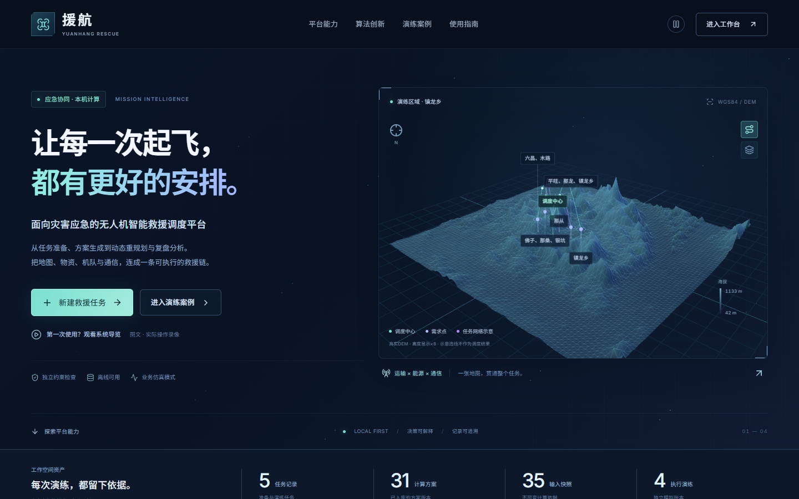
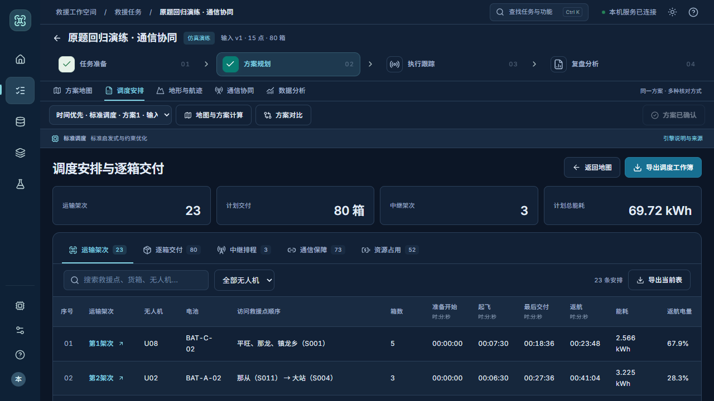

# 援航项目介绍与演示指南

V4参考版　2026年10月19日　Windows 10/11 x64

## 1 项目概览

援航是一套面向灾害应急的无人机运输与通信协同调度系统。在山地断路、洪涝阻隔等场景下，将救援需求、物资箱件、运输无人机、电池、地形和通信资源组织为可追溯的输入，生成具体到架次、访问顺序、箱件、设备和时刻的调度安排。

系统支持真实计算、方案比较、三维地形分析、逐箱安排表、业务模拟、突发变化后的调整和执行复盘。业务流程为“任务准备 → 方案规划 → 执行跟踪 → 复盘分析”。

首页展示本地真实DEM地形、任务与方案数量，提供新建任务、演练案例及使用指南入口。地形主视觉的连线为任务网络示意，实际求解航线在任务地图中查看。

本包已带可运行环境和现有演示记录。完整解压后双击start.cmd，浏览器将打开http://127.0.0.1:8000/；无需另装Python或Node。

<!-- pagebreak -->

## 2 启动与任务准备

请先完整解压到本地文件夹，不要在压缩软件内运行。保持启动窗口开启；关闭窗口或按Ctrl+C停止，重启后记录保留。8000端口被占用时，在解压目录终端运行start.cmd --port 8001。

首页进入“救援任务”可查看已有记录，也可在案例库新建演练。默认小场景为5个需求点、32箱物资，便于展示动态调度；另有15点80箱原题、洪涝分级补给和运输通信协同案例。

| 准备步骤 | 操作与作用 |
|---|---|
| 区域基地 | 选择基地、救援点和地形数据，检查点位及地图覆盖 |
| 需求物资 | 设置需要什么、多少箱、优先级与交付期限；逐箱库存单独管理 |
| 机队保障 | 检查机型、机体、电池、初始电量、健康状态及地面资源 |
| 条件检查 | 根据实际输入检查缺项或冲突，处理阻断项后保存并计算 |

方案规划中可选择时间优先、能耗优先或时间与能源折中；三者都保留完整需求、载荷、电量和硬截止等约束。生成过程中显示实际阶段、耗时与候选数量，结果不是固定示例。

默认使用标准调度。EOH增强是可选的本地候选评分包，内置包明确标为规则初始化；普通求解不请求外部模型。可对同一份输入比较两种引擎，但不保证每次结果不同或增强引擎总是更好。

输入保存后形成新版本，计算绑定不可变快照。修改当前输入不会覆盖历史方案；比较结果时应核对是否来自同一快照与同一模型范围。

<!-- pagebreak -->

## 3 查看调度结果

“方案地图”查看实际航线、救援点和架次；点击点位或架次可联动查看详情。“调度安排”为独立页面，按架次或箱件核对访问顺序、运输数量、起止时刻、机体、电池和能源，并支持Excel导出。

资源时序展示机体占用、电池使用与充电。机体返航后的释放和电池充满的时刻不同，不能只看无人机是否已经返回基地。

| 常见指标 | 含义 |
|---|---|
| 最后交付 | 全部计划物资交接完成的时刻 |
| 最后返航 | 所有相关任务最终返回的时刻，可能晚于最后交付 |
| 总能耗 | 当前模型计算的运输能源；联合模式另给中继与联合能源 |
| SOC与SOH | 剩余电量比例与电池健康容量比例 |
| 检查通过 | 在当前输入和声明模型下通过独立约束重建，不代表实飞认证 |

“比较”页面并列查看真实方案、时间与能源、交付与电量差异。同条件下结果相同是允许的，系统不为区分卡片而制造差异。导出的Excel由当前Plan生成，与地图和表格使用同一份结果。

<!-- pagebreak -->

## 4 地形与通信分析

地形页面使用真实DEM，展示三维地形、航迹与垂直剖面。无人机需要依据沿途最高地形和净空要求爬升，访问点后再按下一航段重新计算；不是沿一条固定高度的平面直线飞行。

运输能源随距离、爬升、载荷和设备参数变化。交付物资后载荷减少，返航按空载处理；同时检查机型载质量与体积、电池兼容、初始SOC/SOH、最低返航电量、充电和资源占用。

通信协同案例将运输机控制链路与中继驻点、服务窗口及能源排程一起规划。通信页面可查看直连或两跳中继关系、驻点、服务时段以及指定高度的空间覆盖采样。空间采样与实际航迹连续时间检查是不同视图。

离线地形、航线和分析可直接展示；卫星影像仅为观察底图，需要联网，不会自动提供用于净空计算的高程。地图使用WGS84经纬度，质量、距离、时间与能源分别采用kg、m、s和kWh。

<!-- pagebreak -->

## 5 执行跟踪与复盘

通过检查后先确认方案，再到执行跟踪创建并启动模拟实例。生成、确认和开始模拟是三个动作；当前运行的是服务器业务仿真，没有连接真实无人机。

看板区分准备、载货运输、交接、空载返航和待命，展示已交付与待完成数量、每架飞机当前及下一任务、电池来源、模型速度和预测SOC。页面刷新后从服务器账本恢复，动画不是交付事实的来源。

运输模式中可暂停并注入受支持的变化，查看受影响任务，生成新候选，对比差异后采纳。已交付箱件和已开始的完整架次会保留，剩余任务才重新安排，不能将所有设备重置后从头算。

复盘页面查看计划与模拟交付、任务变更、资源占用及结果导出；只读回放不会新增交付。已有任务和记录随包保留，继续演练只修改当前解压目录的数据，不影响原作者电脑。

通信联合在途修复、真机控制与SITL尚未完成；演示时应使用页面已支持的运输调整。对可能影响已开始承诺的变化，系统会保留约束或要求人工处置。

<!-- pagebreak -->

## 6 算法与系统实现

前端使用React与TypeScript，地图、图表和地形分别由MapLibre、ECharts与Three呈现。后端采用FastAPI、SQLite与独立计算进程，长计算不会作为固定JSON直接返回。计算输入、Job、Plan和执行记录相互关联，可以从结果追溯到原输入。

| 核心环节 | 实现要点 |
|---|---|
| 物理与空间 | DEM净空、实际升降、逐段剩余载荷与能源、静态限制区绕行 |
| 快速调度 | 多起点构造、实际机体与电池日历、逐箱完整保障 |
| 深入改进 | 在有限候选路线池内用CP-SAT优化选择和排程；不宣称全路线空间最优 |
| 通信协同 | 直连或两跳链路、地形遮挡、服务窗口、中继机体和能源联合安排 |
| 动态修复 | 先冻结事实与承诺，沿机体和电池资源依赖定位影响，必要时全量回退 |
| 独立检查 | 从冻结输入重建载荷、时序、能源、SOC及所需通信条件 |
| 可选EOH | 只调整可行候选的本地评分，记录策略版本、来源和实际调用数 |

推荐演示顺序：查看首页 → 打开已有任务 → 核对安排表与资源时间轴 → 查看地形或通信 → 打开执行与复盘 → 新建小演练并真实计算。使用帮助中还提供图文教程、术语解释和实际操作短片。

## 7 数据保存与常见问题

核心数据保存在包内runtime，backup.cmd可创建一致性备份。首次启动前可运行portable-python/python.exe scripts/check_reference_bundle.py --initial-data核对交付文件；使用后数据正常变化，不再将初始数据库hash作为当前状态。

本包面向Windows x64。核心功能无需联网；在线卫星图与外部资料网页需要网络。搜索受预算、硬件和随机过程影响，不承诺不同电脑得到逐位相同结果。EOH内置包不是已经训练完成的学习模型，当前也不具备多用户登录、实时风场能耗或真实飞控能力。
